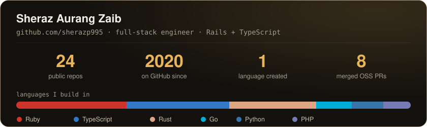

# Sheraz Aurang Zaib

Senior Software Engineer at TechieMinions. I work mostly in Ruby on Rails and TypeScript, and also in Rust, compilers and LLM tooling.

Lahore, Pakistan. Open to remote full-stack, backend and developer-tooling roles.

[Portfolio](https://sheraz-aurangzaib.com) · [LinkedIn](https://www.linkedin.com/in/sheraz-aurangzaib) · [Email](mailto:hello@sheraz-aurangzaib.com)

## Experience

- Senior Software Engineer, TechieMinions (Aug 2025 to present)
- Software Engineer, Orbix Technologies (Aug 2022 to Jul 2025)

## Projects

### [Ruxen](https://github.com/ruxen-lang/ruxen)

I created Ruxen, a compiled, statically typed programming language with Ruby-style syntax and Rust-style ownership. No garbage collector, native binaries.

- ~145K lines of Rust, ~2,000 tests.
- Compiler pipeline: lexer, bidirectional type inference, ownership and borrow checker, SSA-style MIR, Cranelift and LLVM-18 backends.
- Language server, JIT REPL, and a 31-module standard library written in Ruxen itself.
- Three frameworks are built on it: [canvas](https://github.com/ruxen-lang/canvas) (GUI engine), [quiver](https://github.com/ruxen-lang/quiver) (reactive UI) and [rondo](https://github.com/ruxen-lang/rondo) (async web server).

### braceful ([live demo](https://braceful.vercel.app))

An offline browser extension that repairs broken or truncated JSON and opens files of ~100 MB in a virtualized tree. Parsing runs locally in a Web Worker with a streaming tokenizer, off the main thread.

- Solo build, source private.
- ~45K lines of TypeScript across the extension, a Cloudflare Workers billing backend and a marketing site.
- 1,400+ tests, with performance checks in CI.
- TypeScript, Web Workers, Cloudflare Workers, WXT, Playwright.

### Zoiro

A restaurant point-of-sale system: Rails 8 API with a React/TypeScript frontend. I led it and wrote 86% of the commits. Source private, available on request.

- Recipe-based inventory with pessimistic database locking, covered by multi-threaded race tests, so concurrent orders can't oversell stock.
- Order state machine with guarded transitions, and real-time sync across terminals over ActionCable.
- 1,150+ automated tests. CI/CD with Brakeman, RuboCop and bundler-audit.
- Rails 8, React, TypeScript, ActionCable, MySQL.

## Open source

8 merged pull requests to public Ruby projects:

- [foobara/foobara](https://github.com/foobara/foobara/pulls?q=is%3Apr+author%3Asherazp995+is%3Amerged): 5 PRs, including removing `.foobara_delegate` usages and renaming manifest APIs.
- [foobara/rails-command-connector](https://github.com/foobara/rails-command-connector/pull/2): an auto-instantiating `RailsCommandConnector`.
- [leandrosardi/blackops](https://github.com/leandrosardi/blackops/pulls?q=is%3Apr+author%3Asherazp995+is%3Amerged): 2 PRs for file handling and single-binary packaging.

## FlukeBase

I contribute features to [FlukeBase](https://flukebase.me), a startup with several Rails and Next.js products: an AI-agent development platform with a 600+ tool MCP server, and the SaaS apps [FounderSequence](https://foundersequence.com) and [FeelTrack](https://feeltrack.tech).

## Tech

| Area | |
|---|---|
| Languages | Ruby, TypeScript, JavaScript, Rust, Go, Python, Dart |
| Backend | Rails 8, Node.js, Express, PostgreSQL, MySQL, ActionCable |
| Frontend | React, Vue, Next.js, Tailwind CSS |
| Tooling | LLVM, Cranelift, MCP, Docker, Kamal, Cloudflare Workers |

## GitHub stats

